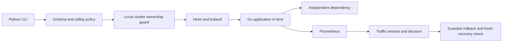
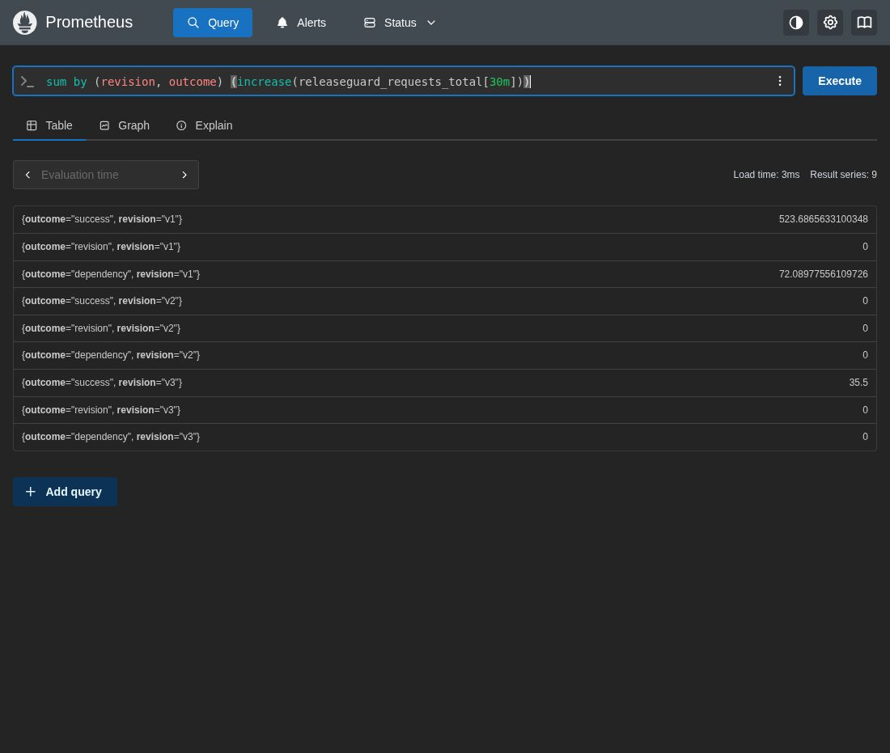

# ReleaseGuard

**Deployment safety, failure attribution, and verified rollback on a real local Kubernetes cluster.**

ReleaseGuard validates a Helm deployment, records a measured healthy baseline, and distinguishes a defective release from an external dependency outage. It rolls back only when the evidence supports doing so, then verifies restored availability and fresh traffic health.

This is an original, AI-assisted engineering portfolio project using synthetic faults and traffic. It is a local reliability exercise, not a production deployment or customer incident history. Original code is currently unlicensed; [third-party notices](docs/THIRD-PARTY-NOTICES.md) remain applicable.

**Review in five minutes:** [failure and recovery evidence](evidence/summary.json) · [readiness incident](incidents/INCIDENT-002.md) · [decision rules](releaseguard/policy.py) · [correctness tests](tests/test_controller.py) · [engineering review](docs/review.md).



## Verified local quick start

Reference platform: Linux/amd64, Docker Engine with `docker image save --platform` support, Python 3.11+, Go 1.27.2, make, curl, tar, and sha256sum. Tested on CachyOS with 16 GB RAM. Keep ports 18080, 18081, and 19090 free; allow several GB for the single kind node and images. Initial setup requires internet access; no paid service is needed.

```bash
make setup
bash scripts/tools.sh
export PATH="$PWD/.local/bin:$PATH"
make test lint audit
make cluster images demo
make integration
```

`make setup` creates only a project virtual environment. Tool installation downloads checksum-verified kind 0.33.0, kubectl 1.37.1, and Helm 4.3.1 to ignored `.local/bin`. `make cluster` creates the dedicated `releaseguard` cluster with a project kubeconfig; it refuses to adopt an existing unowned cluster. It does not switch your global Kubernetes context. `make images` builds three real sample revisions and imports their native-platform images.

`make demo` deploys the sample and records its healthy baseline. [App request](http://127.0.0.1:18080/work), [dependency check](http://127.0.0.1:18081/check), and [Prometheus](http://127.0.0.1:19090) are exposed on loopback. These links work while your local cluster is running.

```bash
.venv/bin/python -m releaseguard --report .local/decision.json assess
.venv/bin/python -m releaseguard --report .local/release.json deploy --image v2
make incident ID=002
```

The incident command reruns the complete bounded integration suite, restores its controlled faults, and prints the selected incident report. `make integration` takes a few minutes and performs real local mutations. Reports remain in ignored `.local/integration/`. Exit 0 means the expected positive CLI state; diagnostic/rejected states exit 2, command errors exit 1. Report options precede the subcommand.

## Implemented and verified

- Strict JSON/YAML configuration, schema and environment-specific manifest policy, bounded resources, local image restrictions, probes, and container security checks.
- Explicit kubeconfig/context/namespace and Docker container ownership checks before mutations. Remote Docker overrides and unrelated/recreated clusters are rejected.
- Supported-field desired/live drift comparison, with JSON paths for differences.
- Actual Prometheus request counters and latency histogram deltas per revision and instance. Counter resets, scrape failures, inadequate samples, and mixed failures block rollback.
- Recorded healthy Helm revision and deployment identity; guarded rollback followed by restored-template, rollout, and fresh traffic verification.
- Separate dependency deployment: its failure degrades work requests without changing the app revision or triggering an app rollback.

| Exercise | Measured local outcome |
|---|---|
| Unsafe production-profile fixture | Rejected for zero replicas, mutable image, and missing resources |
| v2 readiness defect | Candidate failed readiness; rollback restored v1 and healthy traffic |
| Dependency outage | Requests failed; unchanged app revision; no rollback |
| v3 latency regression | Ready candidate exceeded the 0.5 s bucket-p95 threshold; verified rollback |
| Live replica drift | `/replicas` detected; restored comparison returned `in_sync` |

See [captured reports](evidence/summary.json) and [test strategy](docs/testing.md). These are finite local observations, not universal correctness or performance guarantees.

## Running-system evidence



Captured from the real local Prometheus UI on 2026-10-15. The query summarizes 30-minute request increases by revision/outcome. Prometheus `increase` extrapolates at range boundaries, so fractional values are estimates; use the incident JSON counter deltas for exact observed-window counts. v2 receives no service work while unready, while v1 records actual dependency failures and v3 records successful but slow requests. This screenshot is not a benchmark or a production dashboard.

## Why this design

A single kind node provides genuine Kubernetes scheduling and rollout behavior without cloud infrastructure. Helm preserves a concrete prior manifest. Prometheus scrapes unready pods through headless discovery so a readiness failure remains observable even when the service routes work to the old healthy pod. A zero-unavailable rolling strategy preserves that old pod during the defective rollout.

Health uses **fresh counter differences**, not lifetime error totals. Bucket p95 is a conservative bucket bound, not an exact percentile. Rollback attribution requires a changed app template, a previously measured healthy baseline, healthy independent dependency, and usable candidate telemetry. Command success alone never establishes recovery.

[Architecture and contracts](docs/design.md) · [operating runbook](docs/runbook.md) · [technical decisions](docs/decisions.md) · [review and limitations](docs/review.md).

## Boundaries

This is not a general production Kubernetes controller. It supports one fixed local app, three controlled sample images, one node, and explicitly documented drift fields. The production profile is validation-only and never authorizes a remote deployment. The owner-controlled baseline is not signed or time-expiring; protect local files and create a new baseline after intentional changes. There is no canary router, distributed lock, HA controller, durable telemetry, or cluster-wide admission policy. Version-tagged application base images remain mutable upstream. Concurrent operators are unsupported.

The code and incident fixtures were created with AI assistance and verified with the recorded commands. Study the [incident investigations](incidents/) and explain the contracts independently before presenting them as evidence of your own understanding.
